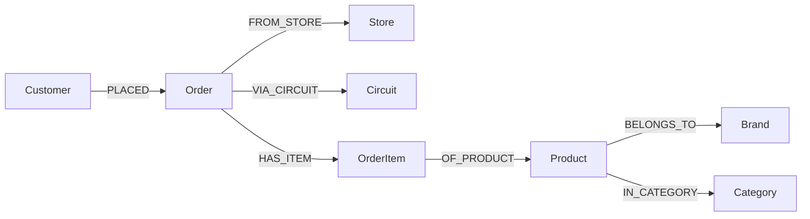

# Store GraphRAG — Graph Hacks submission

A natural-language interface over a retail knowledge graph. Ask a question in
plain English; the app turns it into a Cypher query, runs it on **FalkorDB**, and
shows the resulting rows — with the generated query visible for every answer.

**Hackathon:** [Graph Hacks: Context for AI Agents](https://www.wemakedevs.org/hackathons/falkordb) — WeMakeDevs × FalkorDB, Oct 15–18, 2026.

**Track:** **Agents That Act on Connected Data**

> The assistant acts on connected data: for every question it generates a graph
> query, validates it against the ontology, and runs it on FalkorDB to produce
> the answer. Name every track you submit when filing.

---

## Demo video

▶️ **[Watch the demo video](https://youtu.be/IK7kVZzq3Pk)**

The video walks through:

1. starting FalkorDB and populating the graph from the shipped dataset,
2. the FalkorDB Browser showing the populated graph,
3. the Streamlit app answering natural-language questions,
4. the generated Cypher query behind each answer.

---

## What it does

The product lets a non-technical user query a store's order data without writing
Cypher. Instead of a fixed dashboard, every question is translated into a graph
query on the fly, so the answer follows the question.

- **Input:** a question in natural language (e.g. *"which products were sold in
  February 2025?"*).
- **Process:** GraphRAG-SDK + LiteLLM generate a Cypher query, which is validated
  against the graph ontology (entity and relationship directions) and retried
  with the validator's feedback if it is wrong.
- **Output:** the matching rows in a table, the Cypher query that produced them,
  and JSON/CSV export.

**FalkorDB does the real work:** the graph is the store's business data (orders,
items, products, brands, categories, customers, stores, circuits). Remove
FalkorDB and there is no product — the questions are answered by graph
traversals, not by a table scan or a vector store.

---

## Graph data model

Ontology: 8 node labels and 7 directed relationships.

### Nodes

| Label       | Key attribute         | Attributes                                                   |
|-------------|-----------------------|--------------------------------------------------------------|
| `Customer`  | `id` (unique)         | `name`, `email`, `mobile`, `birthdate`                       |
| `Order`     | `order_id` (unique)   | `order_date`                                                 |
| `OrderItem` | `id` (unique)         | `quantity`, `amount`                                         |
| `Product`   | `product_id` (unique) | `name`, `description`, `ean`, `minsan`, `list_price`         |
| `Brand`     | `name` (unique)       | —                                                            |
| `Category`  | `name` (unique)       | —                                                            |
| `Store`     | `id` (unique)         | —                                                            |
| `Circuit`   | `code` (unique)       | —                                                            |

### Relationships (directed, source → target)



| Relationship  | Source      | Target      |
|---------------|-------------|-------------|
| `PLACED`      | `Customer`  | `Order`     |
| `FROM_STORE`  | `Order`     | `Store`     |
| `VIA_CIRCUIT` | `Order`     | `Circuit`   |
| `HAS_ITEM`    | `Order`     | `OrderItem` |
| `OF_PRODUCT`  | `OrderItem` | `Product`   |
| `BELONGS_TO`  | `Product`   | `Brand`     |
| `IN_CATEGORY` | `Product`   | `Category`  |

The ontology is stored in `data/store_orders_ontology_new.json` and is also
persisted in FalkorDB as the `{kg_name}_schema` graph by the SDK.

A typical traversal for *"products sold in February 2025"* goes
`Order → OrderItem → Product`, following the arrows left-to-right.

---

## Cypher queries the product depends on

The product relies on two kinds of Cypher: **ingestion** (deterministic, in
`store/build_graph.py`) and **query generation** (LLM-generated at request time,
validated before execution).

### 1. Ingestion

Indexes:

```cypher
CREATE INDEX ON :Customer(id)
CREATE INDEX ON :Store(id)
CREATE INDEX ON :Order(order_id)
CREATE INDEX ON :OrderItem(id)
CREATE INDEX ON :Product(product_id)
CREATE INDEX ON :Brand(name)
CREATE INDEX ON :Category(name)
CREATE INDEX ON :Circuit(code)
```

Products, brands and categories:

```cypher
UNWIND $rows AS row
MERGE (p:Product {product_id: row.product_id})
SET p.name = row.name, p.description = row.description,
    p.ean = row.ean, p.minsan = row.minsan, p.list_price = row.list_price;

UNWIND $rows AS row MERGE (b:Brand {name: row.brand});
UNWIND $rows AS row MERGE (c:Category {name: row.category});

UNWIND $rows AS row
MATCH (p:Product {product_id: row.product_id})
MATCH (b:Brand {name: row.brand})
MATCH (c:Category {name: row.category})
MERGE (p)-[:BELONGS_TO]->(b)
MERGE (p)-[:IN_CATEGORY]->(c);
```

Orders, customers, stores, circuits and items:

```cypher
UNWIND $rows AS row
MERGE (cust:Customer {id: row.account_org_id})
SET cust.name = row.name, cust.email = row.email,
    cust.mobile = row.mobile, cust.birthdate = row.birthdate
MERGE (store:Store {id: row.business_entity_id})
MERGE (circuit:Circuit {code: row.circuit_code})
MERGE (ord:Order {order_id: row.order_id})
SET ord.order_date = row.order_date
MERGE (cust)-[:PLACED]->(ord)
MERGE (ord)-[:FROM_STORE]->(store)
MERGE (ord)-[:VIA_CIRCUIT]->(circuit)
MERGE (item:OrderItem {id: row.order_item_id})
SET item.quantity = row.quantity, item.amount = row.amount
MERGE (ord)-[:HAS_ITEM]->(item)
WITH row, item
MATCH (p:Product {product_id: row.product_id})
MERGE (item)-[:OF_PRODUCT]->(p);
```

### 2. Query generation (text-to-Cypher)

At request time the model receives the graph ontology (8 labels, 7 directed
relationships) plus the user question and returns an OpenCypher statement. The
statement is **validated** against the ontology; if it is rejected, the
validator's error is fed back to the model and it retries (up to 5 times). This
is implemented in `store/kg.py` (`generate_cypher`).

### 3. Example generated queries

```cypher
// Which products were sold in February 2025?
MATCH (o:Order)-[:HAS_ITEM]->(oi:OrderItem)-[:OF_PRODUCT]->(p:Product)
WHERE o.order_date >= '2025-02-01' AND o.order_date < '2025-03-01'
RETURN DISTINCT o.order_date, p.product_id, p.name, oi.quantity, oi.amount;

// Top 5 best-selling products with revenue and category
MATCH (o:Order)-[:HAS_ITEM]->(oi:OrderItem)-[:OF_PRODUCT]->(p:Product)
MATCH (p)-[:IN_CATEGORY]->(c:Category)
RETURN p.name, c.name AS category, SUM(oi.quantity) AS qty, SUM(oi.amount) AS revenue
ORDER BY revenue DESC LIMIT 5;

// Customers who spent the most in 2025
MATCH (c:Customer)-[:PLACED]->(o:Order)-[:HAS_ITEM]->(oi:OrderItem)
WHERE o.order_date >= '2025-01-01' AND o.order_date < '2026-01-01'
RETURN c.id, c.name, SUM(oi.amount) AS total_spent
ORDER BY total_spent DESC LIMIT 10;
```

---

## Data & anonymization

The repository ships a **reduced, anonymized** dataset (`data/`):

| File | Rows | Notes |
|------|------|-------|
| `store_orders.parquet` | 10,000 order rows | 3,382 synthetic customers, 2,819 referenced products, dates 2024-01-01 → 2025-12-31 |
| `store_products.parquet` | 6,520 products | catalog (1,203 brands, 5,132 category strings) |
| `store_orders_ontology_new.json` | — | graph ontology |

**Anonymization / transformation applied to orders:**

- `account_org_id` → sequential integer
- `name` → synthetic `SURNAME FIRSTNAME`
- `email` → synthetic `customerNNNNN@example.com` (nulls preserved)
- `mobile` → synthetic `333NNNNNNN`
- `birthdate` → synthetic date in 1940–2005
- `business_entity_id`, `circuit_code` → constant `1`

Personal data from the original source is never shipped. The transformation is
reproducible with `tools/make_anonymized_dataset.py`.

---

## Repository structure

```
falkordb_hackaton_3_pizze/
├── README.md                    # this file
├── LICENSE
├── .gitignore
├── .dockerignore
├── .env.example                 # LLM endpoint template (copy to .env)
├── requirements.txt
├── Dockerfile
├── docker-compose.yml           # FalkorDB + loader + Streamlit app
├── app.py                       # Streamlit UI (query entrypoint)
├── store/
│   ├── __init__.py
│   ├── config.py                # configuration from env vars
│   ├── kg.py                    # model, knowledge graph, Cypher generation
│   └── build_graph.py           # graph ingestion (phase 1)
├── data/
│   ├── store_orders.parquet
│   ├── store_products.parquet
│   └── store_orders_ontology_new.json
└── tools/
    └── make_anonymized_dataset.py
```

---

## Configuration

All settings are environment variables (see `store/config.py`). Copy
`.env.example` to `.env` and fill in your own values — the shipped defaults are
placeholders and no real endpoint is committed.

| Variable        | Default                              | Description                    |
|-----------------|--------------------------------------|--------------------------------|
| `FALKORDB_HOST` | `localhost` / `falkordb` (in Docker) | FalkorDB host                  |
| `FALKORDB_PORT` | `6379`                               | FalkorDB port                  |
| `KG_NAME`       | `store_orders_products_new`          | Knowledge graph name           |
| `VLLM_API_BASE` | `http://localhost:8000/v1`           | OpenAI-compatible LLM endpoint |
| `VLLM_MODEL`    | `your-model-name`                    | Served model id                |

The app talks to any OpenAI-compatible endpoint (vLLM is what we used). The model
must be served under the id you put in `VLLM_MODEL`.

---

## Quick start (Docker — recommended)

Requires Docker + Docker Compose and a reachable OpenAI-compatible LLM endpoint.

```bash
cp .env.example .env        # then edit VLLM_API_BASE / VLLM_MODEL
docker compose up --build -d
docker compose logs -f loader   # wait for "Graph successfully populated."
```

Open **http://localhost:8501** for the app and **http://localhost:3001** for the
FalkorDB Browser.

### Step by step

```bash
docker compose build
docker compose up -d falkordb       # 1) graph database
docker compose run --rm loader      # 2) populate the graph (one-shot)
docker compose up -d app            # 3) Streamlit UI
```

Useful commands:

```bash
docker compose logs -f app
docker compose down            # stop, keep the graph volume
docker compose down -v         # stop and delete the graph
```

---

## Local setup (without Docker)

Requires Python 3.10–3.13 and a running FalkorDB on `localhost:6379`.

```bash
pip install -r requirements.txt

# 1) populate the graph
python -m store.build_graph

# 2) run the UI
streamlit run app.py --server.port 8501
```

Set `VLLM_API_BASE` and `VLLM_MODEL` (in `.env` or the environment) before
starting the app.

---

## Deployment

A public live deployment is **not provided**: the app needs a FalkorDB instance
and an OpenAI-compatible LLM endpoint, and the team's model server is private.
The complete local setup above is therefore the supported way to run the project
(rule 10 alternative: *"complete local setup instructions"*).

To deploy elsewhere, run FalkorDB (Docker image `falkordb/falkordb`) and expose
the Streamlit app from the same image; point `FALKORDB_HOST` and `VLLM_API_BASE`
at your services.

---

## Technical notes

- **Stack:** FalkorDB, [GraphRAG-SDK](https://github.com/FalkorDB/GraphRAG-SDK),
  LiteLLM, vLLM (OpenAI-compatible), Streamlit, Polars, Docker Compose.
- **Reasoning models:** the deployed model is a reasoning model (Qwen3.6). Its
  "thinking" output lives in a separate `reasoning` field, so the SDK (which reads
  `content`) would see empty answers and hang. The app disables thinking via
  `chat_template_kwargs: {"enable_thinking": false}`, which makes responses fast
  (~1 s) and puts the answer directly in `content`.
- **Query validation:** generated Cypher is validated against the ontology
  (including relationship directions) before execution; invalid queries are
  retried with the validator's feedback.
- **Relationship direction:** the system prompt lists every relationship as an
  explicit arrow, which keeps non-thinking models from reversing edges.

---

## AI disclosure

The team used AI coding assistants for implementation support (scaffolding,
boilerplate, documentation drafts). All code was reviewed, verified and tested by
the team; the graph model, the queries and the architecture are the team's own
decisions and can be explained in detail.

---

## License

MIT — see `LICENSE`.
